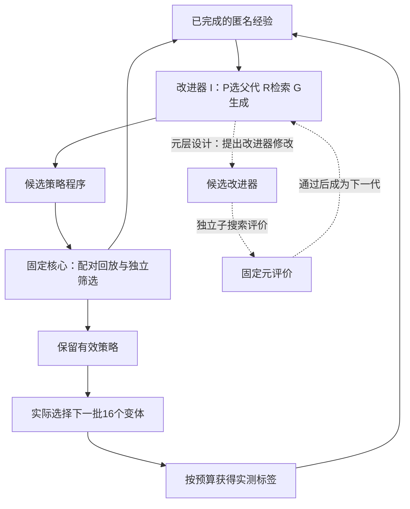

# 蛋白实验设计中的 RSI：问题定义、相关工作与我们的设计

这项研究要回答的问题是：**在有限的蛋白测量预算下，系统能否利用已经获得的实验经验，持续改进选择下一批实验的方法，并进一步改进产生这些方法的改进器？**

研究对象包含两类程序：负责选样的策略程序，以及负责修改程序的改进器。蛋白性能提供外部评价依据。我们关注程序与系统层面的递归自改进，基础语言模型的权重保持固定。

本文依次解释蛋白优化问题、RSI 的含义、相关工作的联系、系统设计、验证方法和目前进展。项目状态以 **2026年10月13日已完成并确认的研究记录**为准；正在开发的组合编辑与元层不计作已验证成果。当前已建立策略搜索和评价框架，尚未证明 RSI 优势或改进器自修改有效。

## 一 研究问题与适用范围

蛋白工程通常从一个已有蛋白和一个明确目标出发，例如提高结合能力或催化活性。把一个候选突变组合记作 x，把它在指定实验条件下的实测性能记作 f(x)。这里的“适应度”指具体测定中的功能指标，不等于蛋白在所有环境下的普遍优劣。

我们的近期任务是在**预先确定的候选集合**中，逐批选择值得测量的变体。以 GB1 的四个位点组合为例，理论组合数为 20⁴，也就是160,000；实际可用候选集合仍以经过审计的数据为准。原始 GB1 研究的一部分分析补全过缺失值，因此数据处理必须区分实测与插补，不能把所有理论组合都视为可靠实测标签。[GB1 原始研究](https://elifesciences.org/articles/16965)

一次优化回放先获得32个初始观测，然后进行8轮选样，每轮16个未测变体，总预算为160个标签。第 t 轮开始时，系统只知道此前已经测过的集合 Dₜ。策略 π 根据这些观测及合法诊断选择批次 Bₜ，测量后把新结果加入 Dₜ。

这可以简写为：**Bₜ = π(Dₜ，诊断，剩余预算)**。当前实际接口通过受控数值工具使用 Dₜ，代码生成器只得到匿名诊断与允许的程序信息。

评价关注两个方面：在整个预算过程中多快找到更好的蛋白，以及用完预算后最好找到什么。主指标 nAUBC 是归一化“已发现最佳性能随查询数变化曲线”的面积；当前协议在32、48直到160个标签的九个节点上计算梯形面积，再除以对应的查询区间长度。它不评价获得初始32个标签之前的过程。Best@160 是160次测量后的最佳实测性能。预测误差用于诊断，不能直接替代蛋白发现效果。

当前实验是在已有实测数据上，按预算逐步揭示标签的计算回放。它适合比较策略和检查信息泄漏；推广到新的蛋白和真实湿实验仍需要后续证据。

## 二 理解方法所需的基础概念

**上位性。** 两个突变组合后的作用可能偏离它们各自作用的简单相加。这使得只沿着当前看来最好的单点变化前进，可能错过有价值的组合。GB1 的原始工作展示了适应路径与突变相互作用的关系。[GB1 原始研究](https://elifesciences.org/articles/16965)

**代理模型。** 用已经测过的序列与性能，近似预测其他候选的性能。我们的工具库包含线性模型、高斯过程、五成员神经网络集成，以及显式包含突变交互项的模型。它们只是可调用的数值部件，哪一个更合适需要实测比较。

**采集规则。** 把预测变成选样决策的规则。Greedy 优先选择预测性能高的候选；UCB 用“预测均值＋β乘不确定性”平衡利用与探索；EI 评价超过当前最好结果的期望改进；Thompson sampling 通过抽样形成探索。这里 β 控制探索权重。

**批次组成。** 即使单个候选看起来很好，一批候选仍可能高度相似。多样性、局部或全局候选范围、少量随机名额，都会改变有限实验预算的使用方式。

**主动学习与贝叶斯优化。** 主动学习强调边获取数据边更新模型；贝叶斯优化通常进一步围绕高目标值进行选样。ALDE 把预测模型、不确定性和批次选样连接到蛋白实验闭环，是我们必须理解的领域基础。[ALDE 论文](https://www.nature.com/articles/s41467-025-55987-8)

读到这里需要记住：模型负责估计，采集规则负责排序，批次规则负责组合；最终是否有效，要看实际测到的蛋白性能。

## 三 我们采用的 RSI 定义

RSI 是 Recursive Self Improvement，即递归自改进。不同工作对“自己”与“递归”的范围有不同界定。本文采用一个明确的程序级定义：**系统对自身产生可持续保存的程序修改，经外部评价后保留候选版本；保留后的版本参与产生后续改进。**

可以把三个层次分开理解。

| 层次 | 被更新的对象 | 能说明什么 |
| --- | --- | --- |
| 数据学习 | 蛋白代理模型的拟合参数 | 系统利用了新增观测 |
| 策略改进 | 选择下一批实验的程序 π | 系统能够搜索实验设计方法 |
| 改进器自修改 | 生成后续程序修改的程序 I | 系统的改进机制进入递归循环 |

普通主动学习本来就会反复更新模型。只运行更多轮，或让语言模型反复修改一段输出，都不足以证明改进器的能力提高。Self Refine 是理解“迭代反馈与输出修订”的参考；它本身不能替代我们需要的蛋白评价和元层能力验证。[Self Refine](https://arxiv.org/abs/2303.17651)

STOP 展示了用一个改进程序改进它自身的路径，同时明确指出固定语言模型权重所带来的范围限制。我们也将主张限定在**程序与系统层面的 RSI**，不把它描述成基础大模型自主重训或无界能力增长。[STOP](https://arxiv.org/abs/2310.02304)

还要区分“发生自修改”和“实现自改进”：代码变化能够证明前者，独立任务上的能力增益才能支持后者。

## 四 必须了解的相关工作

下面八项构成理解本项目的阅读主线。每项都对应一个设计问题，研究结果不能直接移作本项目的性能证据。

**1．GB1 适应度景观与间接适应路径。** Nicholas C. Wu 等，eLife，2016，Adaptation in protein fitness landscapes is facilitated by indirect paths。它帮助理解突变相互作用、局部最优和搜索路径，也提供了我们使用的景观背景。阅读重点是数据构成、实测与插补的区别，以及“局部规则为什么可能失效”。[论文](https://elifesciences.org/articles/16965)

**2．机器学习辅助定向进化。** Zachary Wu 等，PNAS，2019，Machine learning assisted directed protein evolution with combinatorial libraries。它把有限实测样本训练出的模型用于组合序列空间筛选，并给出实验应用。对我们的启发是以实测序列功能关系支撑选样；它没有替我们证明改进器自修改。[论文](https://arxiv.org/abs/1902.07231)

**3．ALDE。** Jason Yang、Ravi G. Lal 等，Nature Communications，2025，Active learning assisted directed evolution。它将模型更新、不确定性和批次实验连接起来，并包含湿实验与计算回放。阅读重点是模型、采集规则、批次大小与不确定性评价。它是我们的领域对照来源。[论文](https://www.nature.com/articles/s41467-025-55987-8) [官方代码](https://github.com/jsunn-y/ALDE)

**4．跨景观 MLDE 评价与 SSMuLA。** Francesca Zhoufan Li 等，Cell Systems，2025，Evaluation of machine learning assisted directed evolution across diverse combinatorial landscapes。该工作比较16个蛋白适应度景观中的多种方法；SSMuLA 是对应分析代码库。阅读重点是方法收益如何随景观变化，以及单一 GB1 结果的外推边界。SSMuLA 包含多种流程，我们当前使用的 Boosting Greedy 适配只是其中一种领域对照，不能代表整篇工作的全部方法。[论文](https://pubmed.ncbi.nlm.nih.gov/40934912/) [官方代码](https://github.com/fhalab/SSMuLA)

**5．STOP。** Eric Zelikman 等，COLM 2024，2023年首次预印本。它把“改进程序”本身交给改进器处理，是理解元层闭环最直接的参考。阅读重点是如何定义一个改进器的效用，以及如何评价修改后的改进器。[论文](https://arxiv.org/abs/2310.02304)

**6．Darwin Gödel Machine。** Jenny Zhang 等，2025年首次预印本，2026年修订。它通过修改代理代码、经验评价和保留不同代理分支探索自改进。对我们的启发是保留可能成为后续起点的程序档案，并直接检验修改是否改善能力。其编码任务结果不能直接外推到蛋白实验设计。[论文](https://arxiv.org/abs/2505.22954)

**7．AlphaEvolve。** Google DeepMind，2025。它结合语言模型生成程序、自动评价和演化搜索。对我们的启发是把提案落实为可执行对象并用外部结果评分。蛋白场景中的额外难点是标签有预算、反馈有噪声，并且评价本身有成本；算法搜索的成功也不能单独证明改进器递归有效。[官方介绍与技术报告入口](https://deepmind.google/blog/alphaevolve-a-gemini-powered-coding-agent-for-designing-advanced-algorithms/)

**8．Self Refine。** Aman Madaan 等，2023。它通过同一模型提供反馈并迭代修订输出，适合帮助辨认“输出层的迭代”与“改进机制的持久修改”。我们需要让程序选择真正执行，并通过蛋白任务测量效果。[论文](https://arxiv.org/abs/2303.17651)

建议先读 ALDE 与 STOP，分别理解领域内环和递归外环；随后读 SSMuLA 与 Darwin Gödel Machine；其余四项用于补足生物背景、方法来源和概念边界。

## 五 我们的整体设计

系统记作 S = (π，Iφ)。π 是蛋白选样策略；Iφ 是改进器，φ 表示程序版本及模块。基础语言模型的参数 θ 固定，当前已登记调用模型为 Qwen3.8 27B。

改进器包含三个可研究的模块。

| 模块 | 职责 | 可以研究的修改 |
| --- | --- | --- |
| R 经验检索 | 从本次搜索已完成的匿名记录中选证据和反例 | 按上下文、修改类型与父代行为检索 |
| G 修改生成 | 组织固定语言模型提出合法修改与事前预测 | 改变诊断到修改的规则、提示构造和提案方式 |
| P 父代选择 | 从已评价开发档案中选择展开对象与顺序 | 在当前策略和未充分展开的分支间选择 |

**P 表示父代与提案顺序，不表示自由分配实验预算。** 第一版元研究固定预算分配规则，每次元修改只改变 R、G、P 中一个模块。联合修改或可学习预算分配需要另行登记，作为后续研究。

固定评价核心负责标签权限、合法性、数值工具、扣费、回放、独立筛选和最终统计。候选程序可以提出新版本；接受标准、留出集合、费用上限和原始记录始终由固定核心控制。

下面展示目标设计。策略层已有实现基础；改进器自修改箭头表示待实现并验证的元层。

这张图包含三个时间尺度：一次蛋白回放的8轮选样；多次完整回放构成的策略搜索；多次受控策略搜索构成的改进器评价。一次回放结束后，代理模型权重和序列标签不会自动成为下一次回放可读取的训练缓存。

## 六 策略编辑如何做到可组合

现有16种单次编辑展示了合法修改的范围，但单次模板不足以实现连续演化。可组合编辑需要满足一个核心约定：**子代由当前父代加上明确修改产生，未涉及的父代行为要得到保留。**

举一个设计例子。π₀ 使用 MLP5、UCB 和全局候选池。第一步把模型改为成对上位性模型，得到 π₁；第二步在 π₁ 上把候选池改为局部邻域，得到 π₂。此时 π₂ 应同时保留第一步的模型变化和第二步的候选池变化。若第二步重新从初始模板生成程序，就没有形成连续组合。

条件编辑也要明确范围。例如，“连续两轮停滞时增加多样性”只在对应分支改变行为，其他状态继续执行父代逻辑。每次修改记录目标组件、修改前后程序、适用条件和已有修改的保留情况。

编辑之间还可能不兼容。当前工具约束中，Thompson sampling 要求 MLP5；每轮最多使用两个不同模型。组合产生冲突时，应明确判为不合法，并记录该机会。不能悄悄替换其他部件后仍把它算作原来的单项修改。

语法合法、工具约束通过、条件分支被执行，只能证明程序可运行。接下来还必须检查真实候选批次和发现效果。

## 七 如何估计修改收益与不确定性

一次经验应记录：父代程序、子代程序、修改类型、修改前的匿名上下文、事前收益预测、完整配对结果、行为差异、筛选结论与实际费用。上下文包括父代结构及行为，否则同名修改在不同父代上的含义可能不同。

对子代与父代，在共同初始化 ωⱼ 上各完成一次独立扣费回放，计算配对差值：

**dⱼ = J(子代，ωⱼ) − J(父代，ωⱼ)**

J 是登记的 nAUBC。共同初始化可以减少比较噪声，但两个策略随后选择的变体仍可能不同；各自的完整查询都要记账。历史只纳入已经完成、能够核对的记录。API 失败没有观测到策略收益，不能直接编码成负收益或零收益。

我们需要区分两种不确定性。

| 对象 | 所回答的问题 | 在系统中的用途 |
| --- | --- | --- |
| 蛋白预测不确定性 | 某个未测变体的性能预测有多不确定 | 决定下一批探索哪些候选 |
| 修改收益不确定性 | 某个程序修改相对父代的平均收益有多不确定 | 决定修改的优先级及是否值得进一步验证 |

**拟补全的收益估计设计。** 先按修改类型与父代上下文检索完成记录，保留正反例，再报告局部平均配对收益、样本支持量和区间。没有相似记录时返回“证据不足”。第一版优先采用可解释的匹配与统计，不把复杂预测器当成默认必要条件。

同一搜索链里的多个候选可能复用初始化，不能把所有差值当成彼此独立的样本。候选的配对区间与跨链聚合的重采样需要分别处理依赖结构。置信区间描述估计的不确定性，不能当作单次下一轮收益的保证，也不等同于语言模型的自述置信度。

历史估计应按时间顺序或留出链评价：只能用当时已有记录预测后续修改，再核对预测与实际结果。我们关心它是否改善提案排序和搜索效率，而不只关心拟合误差。

这些估计是给定父代和上下文的修改收益线索。多处联合变化的收益属于整项修改；没有额外对照时，不能分摊给每个字段，也不能从选择过的历史记录直接宣称因果规律。

## 八 如何验证实际选样行为

行为验证需要两种互补证据。

**同一观测前缀上的选样比较。** 在完全相同的已测数据、轮次、候选集合与受控随机条件下，分别运行父代和子代，比较下一批16个候选。可以报告批次集合重合率、候选距离、局部候选池是否回退、实际模型调用和条件分支是否触发。这个阶段只运行选点而不揭示新标签，因此可以检查行为差异，却不能据此宣称蛋白性能提高。

**独立完整回放的比较。** 父代和子代从共同初始化出发，各自完成160标签回放。报告整条发现曲线及配对指标。后续每轮的批次差异同时受到程序变化和前面观测变化影响，因此需要与“同一前缀”比较分开解释。

两个常见误判是：代码文本变了，但排序和选样完全相同；仅候选顺序变化，就被算成发现了新的批次。对于同时测量的一批蛋白，首先检查集合差异。条件编辑未触发时，需要报告它在本次状态下未生效。

完整示例可以这样理解：系统观察到停滞，检索到相似父代上的多样性编辑记录，提出候选修改；在同一前缀上确认它改变了选样集合；随后通过完整配对回放评价收益；最后进入独立筛选。这个例子描述验证流程，不代表该修改已经取得正收益。

## 九 如何验证递归自改进

评价策略 π 时，问的是“它找蛋白找得怎么样”；评价改进器 I 时，问的是“给它相同起点与搜索资源，它能产生多好的策略”。因此，元层评价必须运行真正的受控子搜索。

**建议的元层实验。** 为旧改进器 I₀ 和候选改进器 I₁ 提供共同的初始策略、合法经验边界与逐项预算上限。每个改进器在开发部分完成策略搜索，冻结其选出的策略，再用独立留出回放评价这些策略。对子搜索进行多次重复，比较最终策略质量、有效更新率和资源消耗。

如果 I₁ 通过独立元筛选，下一次改进器候选应由 I₁ 参与产生。固定驱动器继续控制费用、权限与接受规则。这一步把“新版本参与后续改进”落实到实际执行。

第一版应包含固定改进器、R自修改、G自修改、P自修改的对照；后续再研究联合修改。子搜索效用、重复次数、停止规则与接受阈值必须在看结果前登记，不能事后把最好的一次搜索当成递归能力提高的证据。

在蛋白层面，需要固定强基线、同预算随机程序搜索、无历史、极值历史、条件历史，以及历史结果置乱等对照。比较的作用分别是排除固定工具库本身、更多搜索机会、更多上下文以及无关历史造成的表面收益。领域基线采用何种适配，也必须写清与原论文设置的差别。

数据划分需同时考虑两个层次：同一蛋白上的新初始化检验对起点的稳健性；完全留出的蛋白景观才检验跨蛋白迁移。TrpB4 在当前项目中只做数据审计，正式使用必须等对应方法冻结。若只有少数景观，跨蛋白结论仍然有限。

## 十 预算与证据规则

**160个标签是一次蛋白回放的预算，不是训练整个 RSI 系统的总成本。** 总费用至少分为策略开发、独立筛选、元层子搜索和最终评价，并另报语言模型请求、token、计算时间及失败调用。只比较最后部署时的160个标签，会遗漏搜索得到策略的代价。

项目中的“付费观测”首先指逻辑标签预算已扣除，并不表示当前每个标签都发生了新的湿实验支出。同一个候选在独立回放中再次被查询，也应按该回放的预算规则记账。

标签边界必须清楚：数值执行器可以使用本回放已经测过的数据；生成器只看到许可的匿名摘要；未测真值、其他回放的序列标签缓存和全库适应度统计不能作为提案输入。评价器若需要全景观归一化常数，只能将它们用于登记的评价，不得借此构造检索特征或选样规则。

策略筛选与最终确认要分开。原 v4 的策略筛选使用平均 nAUBC 改善至少0.01、收益区间下界大于0、终点归一化最佳性能退化不超过0.02等登记条件。最终主要比较另外考虑搜索链与初始化的配对结构及五项比较的 Holm 校正。这些阈值属于该轮协议；后续实验若需要调整，必须另行事前登记。

程序非法、重复提案和失败请求都保留机会与费用。原始阴性结果保持不变。新的工程成功、API 恢复或某个程序可以运行，都不能替代新的独立性能证据。

## 十一 当前实现与待完成设计

以下是截至2026年10月13日已确认记录的状态，后续开发代码只有完成相应验收后才应更新本节。

| 部分 | 已确认状态 | 可以支持的结论 |
| --- | --- | --- |
| 代码化策略与数值执行 | 已实现并完成正式回放 | 策略能够通过真实选样影响回放 |
| 历史检索与固定提案器 | 已实现并进行比较 | 可以研究不同历史输入方式 |
| 16种受约束单次编辑 | 已完成工程实现 | 可表达比旧提案更广的修改范围 |
| 当前父代上的连续组合编辑 | 正在补全 | 尚不能视为完整多代机制已验证 |
| 条件修改收益及不确定性估计 | 待补全并独立验证 | 现有配对结果不等于可靠收益预测器 |
| 同一前缀与完整回放的行为验证 | 正在补全 | 两类证据需要分别报告 |
| R与G与P的自修改 | 尚未完成验证 | 尚不能宣称改进器递归能力提高 |
| 跨蛋白正式评价与新湿实验 | 尚无支持性结果 | 不能宣称跨蛋白或湿实验有效 |

已完成的 GB1 正式评价采用50个共同新初始化，每次160个标签。条件历史方法和开发阶段选定的强固定基线 MLP5 UCB，nAUBC 均约为0.6244；主要五项预注册比较均未通过。[已发布正式结果](https://asimfish.github.io/protein-rsi-report/final.html)

这一结果有具体机制背景：四个 Qwen 组共400次提案机会，211次请求失败、151次重复、38次进入评价；评价过的程序跨链只有7种，沿用 MLP5、UCB 和全局候选池；27次独立筛选没有一次收益区间下界大于0，20条链最终都保留初始策略。这支持“实际策略搜索不足”的诊断，不能据此判断整个 RSI 研究方向无效。

新接口的12次固定工程请求仅2次成功；之后8次输出长度配对诊断，两种长度上限均为2/4成功。它们说明工程可靠性仍有限，不能把未测机会当成策略性能差，也不能把成功编译当成性能改善。[已发布工程记录](https://asimfish.github.io/protein-rsi-report/pilot.html)

当前设计重点因此是：先让修改能继承与组合，确认它改变真实选样，再验证收益估计能帮助产生有效更新，最后检验改进器自修改。

## 十二 我们希望建立的研究贡献

目前的研究主张可以分成三个待检验问题。

**第一，历史能否指导修改。** 给定父策略和当前诊断，包含成功与失败的经验，是否比无历史、极值历史或置乱历史更有助于选择有价值的修改。

**第二，程序修改能否改善蛋白发现效率。** 合法修改是否造成可解释的选样变化，并在独立回放中带来超过强固定方法及同预算程序搜索的收益。

**第三，改进器能否递归变强。** 对 R、G、P 的修改是否提高后续受控搜索的质量，并且新改进器继续参与下一轮改进。

这些问题把蛋白任务与程序自改进连接起来。当前贡献定位是提出并构建可检验的实验设计框架；性能优势、递归增益和跨蛋白泛化需要分别建立证据。单纯将现成组件连接起来，不能自动得到方法新颖性或效果优势的结论。

## 十三 对外介绍时可以使用的表述

> 我们研究蛋白实验设计的递归自改进。在有限测量预算下，系统用已经获得的实测反馈评价选样策略，把修改的成功与失败保存为经验，并据此提出下一代可执行策略。进一步，我们让历史检索、修改生成和父代选择这些改进机制成为可修改对象，检验新改进器是否更善于产生有效策略。整个过程中，标签权限、预算和评价规则保持固定。当前我们已经建立策略搜索与评价基础，正在补齐组合编辑和收益反馈；改进器自修改及性能优势仍是待验证目标。

如果听众追问“和普通主动学习有什么关系”，可以回答：主动学习提供蛋白测量与模型更新的内环；我们的策略层研究如何改写选样程序，元层研究如何改写产生这些程序的改进器。

如果听众追问“为什么叫递归”，应说明：设计要求被保留的新改进器参与生成下一轮改进；目前需要完成并验证这一执行链，不能只用多轮运行或代码版本增长来证明递归有效。

如果听众追问“是否已经超过现有方法”，应直接回答：当前正式比较尚未证明优势，已有阴性结果正在用于定位并改进生成和选择机制。

## 附录 项目依据与术语

**项目依据。** 设计定义来自 research/RSI_SYSTEM_DESIGN_20261011.md 中的两类程序、固定核心、R/G/P 和历史收益设计；实现依据来自 program_study_v4 的 programs.py、program_tools.py、history.py、paid.py、study.py 与 contract.py；单次编辑范围来自 program_generator_v5/source/edits.py。它们是历史项目路径，文中没有把拟议接口等同于当前已完成代码。已确认数值对应文中链接的正式结果与工程记录。

**回放。** 用已有数据作为受限查询环境，模拟一次按预算推进的优化活动。

**父代与子代。** 一次程序修改前后的版本；未通过部署筛选的已评价程序，可以按登记规则留在开发档案中，但不因此成为正式部署策略。

**候选档案。** 已评价程序、上下文、结果与费用的记录集合。

**独立筛选。** 使用与提案开发分开的初始化或任务，决定是否接受候选。

**元评价。** 运行受控策略搜索，衡量改进器产生策略的能力；它比单次评价一个策略多一层。

**nAUBC。** 用归一化的最佳已发现性能曲线，衡量整个查询预算期间的发现效率。

**原始依据与设计建议。** 相关工作中的事实由各段原始链接支持；本文关于条件收益估计、元层对照和推进顺序的具体方案是本项目设计或建议，尚不构成已完成实验结果。
