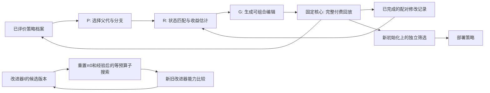

# 下一轮RSI机制改进：按决策状态估计收益，保留分支，独立决定部署

日期：2026-10-14。本文是基于已完成 v7 结果的前瞻设计与实施顺序，不是已实现功能、正式登记或新性能结果。旧 v4/v6/v7 冻结源及结果保持不变。下一轮仍为 GB1 历史实测数据回放，32初始化、8轮每轮16、每回放160；TrpB4只做审计。CPU每进程2线程，复用 .venv，不使用远程付费机器，wandb关闭。

## 1. 直接证据和仍需验证的解释

v7完成160回放、25,600逻辑标签查询，API0，失败和未结算0。训练6个初始化、最终开发验证12个初始化来自同一个GB1景观，不能当作不同蛋白或独立生物重复。

|已核对事实|机制含义|不能直接推出的结论|
|---|---|---|
|utility.py有67个特征，训练54个配对记录只有6个独立初始化|模型复杂度相对独立信息量偏大；应简化估计、按初始化验证|不能仅凭维数断言所有误差都是过拟合|
|context()取八轮诊断均值，验证预测再用训练父代的均值上下文|模型不能区分修改时刻、剩余预算和最近诊断变化|尚未证明阶段信息就是P7方向反转的唯一原因|
|四个单步编辑的预测均值都为负，均值规则仍选择P6（预测−0.002212）|该规则是“选一个编辑”的比较器，没有“不修改”选项|这不是全部系统都强制部署负收益；原保守规则确实保留P0|
|P7训练预测为−0.008976，区间[−0.080698,−0.002350]；验证配对均值+0.005947|出现迁移到新初始化后的收益方向差异，需要检验表征、估计偏差和初始化差异|单个验证均值落在区间外，不等于已识别因果原因或建立覆盖率|
|P3影子比较60/96轮、P7为17/96轮改变实际候选集合|部分修改确实生效；下一步应检验有效修改的条件|行为不同不等于fitness更高；未查询的影子批次没有收益标签|
|编辑器能连续组合，但v7的冻结收益选择只在P0的四个单步子代中选择|软件组合能力尚未成为自适应多代搜索能力|八个固定配置的矩阵不能替代多代RSI实验|
|supported只检查编辑类型是否出现过；父代特征没有覆盖随机槽位、多样性、融合权重等|未见父代组合可能被错误当作已有证据覆盖|不能因此修改已完成v7数据；下一版单独实施并检验|

依据：program_composition_v7/{utility.py,edits.py,experiment.py}、results/mechanism-study/{training-edit-history.json,frozen-utility.json,utility-validation.json}及artifacts/RESULTS.md。读取的均为本轮已经完成的数据，不使用运行中v6的成绩或策略。

## 2. 系统对象和固定核心

继续沿用两类程序：选样策略π和改进器Iφ=(Rφ,Gφ,Pφ)。R负责经验选择及收益估计，G生成结构化编辑，P选择父代和评价顺序。固定核心负责权限、费用、完整回放、部署接受与正式统计。φ是改进器程序版本；Qwen参数θ固定。

图中策略档案、部署策略和改进器版本分别更新。固定核心不受自修改影响。最后一条反馈只有在新改进器实际组织后续搜索时才构成程序级递归；目前尚未实现这条新执行链。

## 3. 改进一：把“修改发生前的状态”作为收益条件

下一轮保存每轮决策前的匿名状态，而不是只保存整条回放的均值：轮次/剩余预算、连续停滞、最近两批预测误差及变化、上一批经验覆盖率、批次距离、已测数据内部交叉验证诊断、父代的完整结构。字段只能由本回放已付费数据构造，缺失值显式保留。不能把这些摘要假设成充分的马尔可夫状态。

要检验“在哪个状态修改有效”，需要在相同已测前缀下比较策略的后续表现。第t轮前已有n_t=32+16(t−1)个付费标签。两个回放独立计费、重新查询相同初始样本和前t−1批：都先执行父代π，随后一个继续π，另一个执行子代T_e(π)。

$$d_{s,e,t}=J(\pi\text{前缀后执行}T_e(\pi),s)-J(\pi,s),\qquad g(e,\pi,c_t)=\mathbb E[d_{s,e,t}\mid c_t].$$

c_t在分叉前保存；J仍是完整32至160查询的nAUBC，终点仍为归一化Best@160。共同前缀产生的相同标签也在两个回放中各自付费，不注入旧序列标签缓存。不同策略在分叉后的状态可能不同，不能用子代后续诊断作为事前特征。

影子选样仍只验证动作差异，不生成反事实fitness。不能从父代轨迹补出子代未测标签，也不能以短回放的成绩冒充160预算的完整成绩。

## 4. 改进二：编辑“分支内的动作”，避免改变正常工作状态

当前pool字段作用于整个程序。P7再应用pool_local会同时修改正常分支和触发分支，无法表达“正常时保持MLP/UCB全局选样，确有失配时才换模型并缩小候选池”。

新编辑对象包含：父代版本、修改路径（默认动作/条件/条件分支动作）、字段、原值、新值。每个动作独立表示模型、采集函数、β、池、多样性、随机名额和融合；条件表示诊断字段及阈值。修改某条分支的pool不应连带修改默认pool；新增条件不重置已有动作。

第一组候选采用2×2设计，固定相同的替代模型/采集函数：

|条件|触发时mixed epistasis + EI的候选池|
|---|---|
|连续停滞|全局|
|连续停滞|elite_hamming_1局部池|
|连续停滞且近期预测误差较高、经验覆盖较低|全局|
|连续停滞且近期预测误差较高、经验覆盖较低|elite_hamming_1局部池|

默认动作统一为MLP5/UCB/全局。阈值只在开发数据上确定并在下一阶段前冻结，不预先称某个误差阈值有效。多字段组合的收益归于整个编辑；单因素及交互项通过此因子设计检验，不能把组合收益任意分配给某个字段。

阶段A必须在第一条新查询前冻结四个候选及阈值。可登记的初始候选是停滞≥2；加强条件另要求上一批nRMSE≥1且经验2σ覆盖率≤0.5。这些只是待检验的设计值，不是已识别的最优阈值。若依据A的训练结果修改阈值，改变后的策略必须重新完整付费评价；不能在旧轨迹上改判定后重算fitness，也不能据A的诊断面板调参并继续称其为独立验证。

程序仍有界：候选必须通过共同解释器，每轮至多两个预测模型，一批恰为16个合法未测变体。所有对照开放相同条件与编辑空间。

## 5. 改进三：简化收益估计，标明无证据的范围

第一版新估计器只使用上述有限编辑族、阶段和少量近期诊断，预先限定至多16个固定特征；暂不恢复67维的全交互。以简单的分组配对均值为参照，再比较正则化条件回归。正则化仅在训练初始化分组交叉验证中选择。

完整父代结构必须保存在历史中。对于训练没有覆盖的模型/采集函数/候选池/分支/融合/随机槽位组合，或明显超出训练诊断范围的状态，返回“无充分支持”；不因编辑名字出现过就提供看似可靠的区间，也不把未知效应当作零。

独立信息量按初始化计算。一次bootstrap同时重采样该初始化的所有编辑和阶段记录，保留共享父代造成的相关性。搜索性能的最终统计还需同时处理搜索链和共同初始化。

分别报告两个不确定性对象：条件平均修改收益的估计不确定性，以及不同新初始化造成的单次收益波动。均值bootstrap区间不能当作单次收益预测区间。不把岭回归加bootstrap称为贝叶斯后验；不声称分布改变后有95%条件覆盖保证。

跨回放保留的是不含序列身份的修改历史和改进器的收益估计参数；它们不预测具体未测蛋白的fitness。蛋白代理模型的训练数据、拟合权重和候选级缓存仍在每个回放重新开始，不能继承。

评估采用未来初始化的真实配对收益：排序相关性、预测误差、收益符号、正收益候选Recall@k、选择后的实际nAUBC及终点。没有符合定义的正收益候选时Recall记不可估计。预测区间宽度与经验覆盖一起报告，不能用非常宽的区间制造“校准成功”。

## 6. 改进四：分开探索、档案保留和部署接受

三个决定采用不同的证据门槛。

1. **探索下一项编辑。** 有支持时用收益均值加不确定性奖励排序，例如a(e)=g_hat(e)+κ SE_hat(e)。κ是预先指定的探索系数；这只是搜索启发式，尚无本项目的bandit遗憾界或校准保证。每代固定至少一个机会探索未见组合；无证据时不输出虚假均值/SE。
2. **保留已评价分支。** 合法且完整评价的候选可进入档案，包括没有达到部署门槛的候选。记录其真实负收益、行为和谱系，允许后续编辑从它出发。档案容量固定，采用质量及行为差异保留少量分支；分支多不等于效果更好。
3. **替换部署策略。** 加入“不修改”，并在新初始化上与当前部署策略比较。保留原标准：平均ΔnAUBC至少0.01、配对95%区间下界>0、归一化终点平均差值≥−0.02。档案子代改善了自己的较弱父代，也不能据此替换更强的部署策略。

这样，不确定性高的候选仍能获得探索机会，而不被直接宣称有效；所有预测为负时，也不会被均值规则强制部署。搜索中不同意接受的结果继续为条件收益提供反例。

档案行为描述只来自已完成的实际执行：各阶段模型使用、条件触发频率、候选池与融合使用、同状态首批/影子Jaccard等匿名统计。当前状态下未触发的条件程序可能在后面触发，因此不能因一批相同就硬删除该程序。

首版档案容量拟定为6：当前部署策略1个、开发质量较高的2个、行为不同的2个、尚未充分展开的1个；槽位重合时按同一规则补足。保留程序需要完整评价及可追溯谱系；行为差异只用于探索优先级，不作为生物收益或正式优势的替代指标。

## 7. 改进五：历史要能支持多代组合与反例检索

历史按“父代完整结构—编辑路径/旧新值—事前状态—实测配对收益—行为差异—费用—筛选结果”追加保存。API失败是执行失败，缺少fitness收益；不能编码成生物负收益。无效和重复记录不增加独立样本数。

R检索匹配父代结构、修改对象和阶段的支持记录及反例，输出证据数量与无证据区域；G据此生成一个可检验编辑；P在有限档案中决定展开父代。当前部署策略不是唯一可编辑对象。

需要检验的组合是“先修改条件，再修改触发动作，再修改触发时的批次组成”。第一步可能没有总体收益，第二步可能使组合有效；不能假设几个单步平均收益可以相加。所有组合都要实际完整回放，并记录谱系。

## 8. 改进器的递归验证：比较产生改进的能力

手工改造I或增加记忆只能构成新的系统设计，不能直接声称系统自修改。元阶段要求当前I生成R/G/P中一个模块的候选程序I′，由固定核心评价；新版本保留后实际组织下一轮修改。一次只改一个模块，预算/接受条件/Oracle/评测器不可修改。

$$Q_{K,B}(I)=\mathbb E[J_{\rm fresh}(\widehat\pi(I;\pi_0,H_0,K,B))-J_{\rm fresh}(\pi_0)],\qquad \Delta Q=Q(I')-Q(I).$$

新旧I从相同π0、相同H0（主比较优先空档案）开始，在相同提案机会K与标签预算B下生成策略，再用另一块新初始化评价选出的策略。不能把更好的继承策略或更多源任务历史带给新I，不能从多条链中只报最好一条。

程序变化证明发生了修改；新的受控子搜索中ΔQ稳定为正才支持改进能力提高。策略nAUBC提高和改进器ΔQ提高分别报告。此范围与STOP的“固定语言模型下改进improver程序”相关，不是基础模型权重递归增长。

## 9. 实施和实验顺序

下列是拟定规模，尚未审计或注册新种子，尚未启动。每阶段先实现，再做独立代码评审和另一fresh Agent逐字执行ENV命令；评审same-family/provisional，工程通过不替代科学证据。旧v7的12个验证初始化可作为先验知情开发依据，不能再次当作独立确认。

### A. 先验证状态表征和编辑收益

训练20个新初始化，另20个新初始化用于机制诊断。每初始化：一个P0完整回放，两个修改时刻t=3/6 × 四个候选完整回放，共9回放。合计360回放、57,600逻辑标签查询。共同父代结果仅在派生统计中复用一次付费记录；它与多个子代的比较不能重复计成独立证据。

模型在诊断开始前冻结；预测只看本候选已付费前缀，不能提前看该初始化父代完整回放的后续诊断。旧均值表征对照只能用已完成训练父代的均值。全部8候选均评价，避免只测预测排名靠前者。

两个比较器使用相同训练记录、相同真实评价矩阵：旧平均诊断/67维估计与新事前状态/简约估计。候选选择都包含“不修改”，避免混入强制编辑缺陷。先比较预测及选择，再判定是否值得扩大条件估计模块；失败也保留数据，修订后需新的诊断面板。

### B. 再检验真正的多代搜索

四个数值机制处理：B0均匀编辑搜索/单一部署父代；B1旧均值收益估计/单一部署父代；B2状态条件收益估计/单一部署父代；B3状态条件收益估计/策略档案父代。共同G先采用有界结构化编辑生成器，API0，避免接口故障掩盖机制。此阶段不能称为Qwen完整系统或改进器自修改结果。

每处理5条独立链，每链5代×4机会；每候选10个共同开发初始化，每代一个候选与当前部署策略在10个新的筛选初始化比较。初始10 + 候选最多200 + 筛选最多100 = 每链最多310回放/49,600标签；4×5链最多6,200回放/992,000标签。无效机会、失败和实际费用完整记录，不能无限补提案；只在本链复用合法已完成的汇总分数，不传递序列标签缓存。累计上限是资源登记，不是要求必须花满。

阶段A若暴露估计问题，先修正并用新数据核验，再冻结阶段B的程序和预算，不提前把参数选择当作正结果。

### C. 冻结策略后确认收益

4处理×5链的全部20个策略，加固定P0/P3/人工自适应P7，共23策略，在50个未参与开发/筛选的新GB1初始化评价。最多1,150回放/184,000标签。50初始化仍不是50蛋白。

主要比较为B3对P0、预声明P3、人工规则P7、同预算随机搜索B0，Holm校正四项；B1/B2用于预声明机制消融。主目标继续采用ΔnAUBC≥0.01、区间下界>0、校正p≤0.05及终点平均差值≥−0.02，不根据结果改指标或换基线。链和共同初始化配对统计，不只挑一条好链。

### D. 接入Qwen并检验改进器自修改

R/G/P和数据界限经上述实测核验后，以固定SJTU endpoint、用户指定Qwen调用名和共同请求预算接入真实提案。旧/新改进器必须使用同一真实模型和解码设置。接口失败、未知usage与科学失败分开；不能把数值生成器的结果登记为Qwen结果。可用性不足时保持数值机制结果边界，不能无限用连通性探针替代研究。

元开发、元筛选、元确认的子搜索单位和费用需单独注册，不从阶段C结果中挑元版本。重置π0/H0、共同K/B、保留新I参与下一轮，以及对旧I/无历史/置换收益的对照，构成第三层的证据要求。阶段D尚无足够依据预定成功代数或性能。

前三阶段拟定上限合计1,233,600逻辑标签查询；本次方案撰写实际新增查询和API请求均为0。先启动A，后续有条件推进，不把资源上限写成完成量。

## 10. 来源及可检验的新设计

- [AlphaEvolve §2.5](https://arxiv.org/html/2506.13131v1)：程序数据库保留候选并平衡质量与多样性。这支持研究档案探索；不能把其其他任务效果外推为本项目收益。
- [Li等，Contextual Bandit](https://arxiv.org/html/1003.0146v2)：基于上下文及不确定性的探索是已有方法。本方案的g+κSE只借鉴探索原则，当前bootstrap区间和非平稳编辑搜索尚不满足其理论假设。
- [STOP，COLM 2024](https://arxiv.org/abs/2310.02304)：improver程序的自修改应通过下游改进能力评价。本项目元层仍需实现并实测，不把手工升级或更多历史本身称为RSI证据。

近期贡献应是：在严格测量预算下，利用可执行编辑、决策前状态、完整付费配对反馈和有限策略档案，检验是否更可靠地产生有益修改。是否获得策略优势、改进器优势和跨任务迁移，各自需要独立证据。
